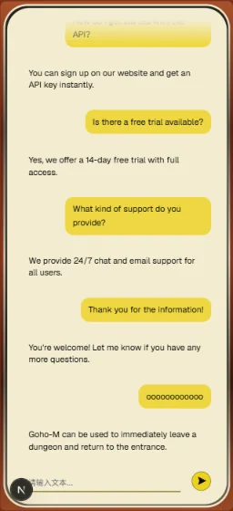

# Persona 4 Golden Inspired AI Web

[English](README.en.md) · [简体中文](README.md)

A Persona 4 Golden inspired game-guide AI portfolio project. The current delivery is a **desktop and small-screen WOOD interface with local simulated chat**. Real AI, retrieval, and backend services are not connected.

## Current Status

Reviewed on 2026-10-20 (Asia/Taipei), including working-tree changes after 8f7d102 that return conversation state to ChatPanel and simplify input management.

- Implemented: submission, multi-turn demo messages, loading, simulated word streaming, error/retry, static Sources, auto scrolling, and an expanding composer.
- One chat DOM tree is shared across layouts. CSS below 48rem changes decorations and geometry without remounting chat or running duplicate chat effects.
- ChatPanel owns messages, status, send logic, and timers. ChatComposer uses an uncontrolled textarea, reads FormData on submission, and resets the form after sending. Stable chat DOM preserves messages and unsent input across breakpoints; refresh/navigation persistence is not provided.
- The owner accepted current browser responsiveness and interactions and retained the existing composer appearance. Exact mobile Figma parity is not claimed.
- **Physical-device keyboard and safe-area checks are deferred.** Extreme unbroken text, wide code blocks/tables, expanded Sources, and very short desktop coverage need focused validation. There are no height-specific desktop rules yet.

## Preview and Design

Desktop WOOD preview.

  

Small-screen WOOD preview with a dedicated frame and shared chat area. Both screenshots show local demo content rather than live AI responses; they do not establish physical-device keyboard verification.

[Mobile Figma reference: 390 × 844, node 21:1484](https://www.figma.com/design/jJbm601weSdkUNfCRVt2xE/Untitled?node-id=21-1484). Current composer and message styling intentionally retain accepted differences.

## Implemented Features

- Desktop wooden TV, antenna, speaker, decorative dials, ground shadow, and CRT screen; separate timber, silver, metal-recess, and glass decoration layers for small screens.
- Stable chat slot alongside decorations. Desktop preserves percentage positioning and aspect ratios; small screens use viewport height and edge insets.
- shadcn MessageScroller / Message / Bubble / Trace, with AI Elements MessageResponse / Streamdown Markdown rendering.
- Enter submission, Shift+Enter newline, IME composition handling, busy submission guards, FormData submission and form reset, and automatic input growth.
- Independent /crt-distortion-test experiment; its distortion filter is not part of the main chat.

## Simulation Limits

Demo messages append every 500ms. Submission waits 1700ms and then appends a fixed reply word by word every 80ms. This is neither model inference nor network streaming.

Submitting error (trimmed and case-insensitive) creates an error card. Retry appends the preceding user content as a new turn rather than replacing the failed turn, so retrying error fails again. Errors persist in message kind while status returns to idle.

Sources use hardcoded demo data, including example.com placeholders. They are not retrieved evidence or verified citations. The ai SDK is installed, but no real chat transport, provider request, or API route is connected.

## Stack

| Technology | Current use |
| --- | --- |
| Next.js 16.4.0 / React 19.3.0 / TypeScript | App Router, components, state |
| Tailwind CSS 4 / CSS Modules | Utilities, TV geometry, responsiveness |
| shadcn/ui: Base UI + Nova | UI primitives |
| @shadcn/react / AI Elements / Streamdown | Scrolling, messages, Markdown |
| SVG / CSS gradients | Desktop assets and mobile frame |
| ai (^7.0.137 in package.json) | Installed; no real chat integration |

Geist and Noto Sans SC are loaded through next/font/google.

## Component Structure

~~~text
Page
├─ Background
└─ Tv: stable scene
   ├─ desktop-decoration
   ├─ mobile-decoration
   └─ wood-chat-panel
      └─ ChatPanel: messages / status / send / retry / timers
         ├─ MessageViewport → MessageItem → Sources / AlertCard
         └─ ChatComposer: uncontrolled input / FormData / form.reset()
~~~

Page, Tv, and the root layout do not declare use client; the chat client boundary is ChatPanel. Responsive layout uses CSS, with no matchMedia shell replacement or duplicate hidden chat instances.

Source lives in src/app, src/components, and src/types/chat.ts. Shared colors are in src/app/globals.css; exported assets are in public/figma.

## Progress and Next Work

| Area | Status |
| --- | --- |
| Desktop / small-screen WOOD and simulated chat | Implemented; current browser behavior accepted by owner |
| Physical-device keyboard / safe-area | Verification deferred |
| SILHOUETTE / theme switching | Not implemented |
| Real LLM, RAG, Web Search, evidence-backed Sources | Not implemented |
| Database / persistence | Not implemented; cloud accounts and long-term chat memory are outside MVP |

Choose one bounded next step when needed: address a frontend issue, resume device checks, implement the other theme, or separately plan real AI integration. Planned backend direction remains local retrieval first, Web Search fallback, and separate retrieval/answer evaluation; these are not available capabilities.

Code-review follow-ups: move replyTimer nulling to timeout callback entry, clear the scrollbar timeout on unmount, and review the local-time EmptyCard greeting for server/client time differences. These are follow-up items; this README edit did not implement or modify those application changes.

Planning/knowledge documents live in the sibling Persona-4-golden directory: PROJECT.md, ROADMAP.md, ARCHITECTURE.md, and DECISIONS.md. That directory is not this application's Git repository. A source-quality audit report exists, but no dataset was collected; its 20-unit recommendation and the 5–8-unit RAG pilot remain separate proposals.

Autonomous Agents, MCP, login, cloud accounts, and long-term Memory are outside MVP. Supabase / pgvector is a planned retrieval store, not implemented cloud chat history.

## Local Development and Checks

Requires Node.js 20.9+ and npm. Local simulation needs no API keys, Supabase, or environment variables. Installing dependencies and fetching Google fonts require network access.

~~~bash
npm ci
npm run dev
~~~

Open [localhost:3000](http://localhost:3000) or [the CRT experiment](http://localhost:3000/crt-distortion-test).

~~~bash
npm run lint
npx tsc --noEmit --incremental false
npm run build
npm run start
~~~

Build before running start. ESLint and TypeScript passed in the 2026-10-20 documentation audit. No production build or new browser/device test was performed. Visual and interaction acceptance is based on the owner's session reports.

## License / Disclaimer

An unofficial fan-inspired portfolio project, not affiliated with or endorsed by ATLUS or SEGA. Persona 4 Golden and related names, trademarks, and official materials belong to their respective rights holders.

No LICENSE file or open-source license is currently declared. This README grants no rights to third-party assets.
