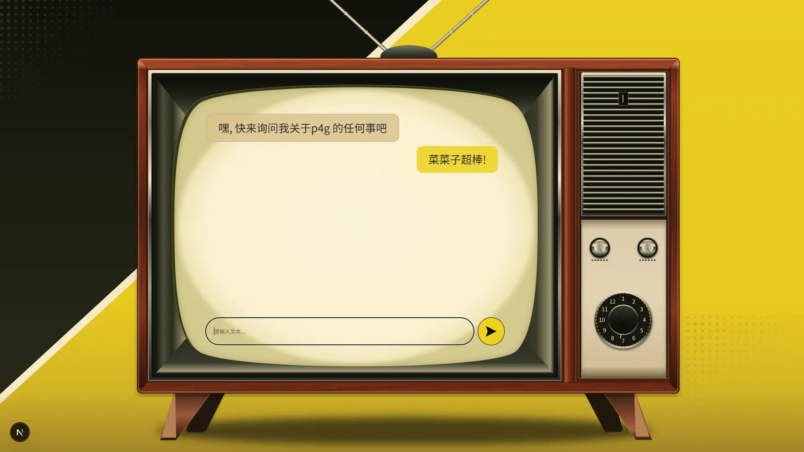

# Persona 4 Golden Inspired AI Web

[English](README.en.md) · [简体中文](README.md)

A Persona 4 Golden inspired web interface built around a retro wooden TV, with a game-guide AI assistant planned for later development.

A personal portfolio project spanning **Frontend Engineering** and, in future stages, **AI Application Engineering**. The current focus is translating a Figma design into a desktop UI shell.

## Project Status

**In progress — desktop WOOD UI shell.** The TV scene, chat presentation, and composer visuals are implemented. Messages are hardcoded examples; the input accepts text, but the send button has no submission logic. No AI services or persistent conversations are connected.

Proportional sizing provides a responsive foundation. Mobile layout and short-viewport handling are not complete.

## Preview



Existing repository screenshot of the desktop WOOD theme. The messages illustrate the UI rather than an AI conversation.

## Features

- Wooden TV shell with antenna, speaker grille, ground shadow, and CRT-style screen.
- Yellow and dark background decorations with diagonal and halftone elements.
- Decorative dials with separate SVG pointers and defined rotation pivots.
- Distinct user and assistant bubbles in a DOM-based message viewport.
- Composer input and send-button presentation with accessible names.
- Scrollbar styling that becomes visible during scrolling and fades after inactivity; long-message overflow handling still needs validation.
- Percentage-based scene geometry, aspect ratios, and clamped message typography.
- A separate CRT distortion experiment at `/crt-distortion-test`, with filter and rendering-scale controls. It is not integrated into the main screen.

## Tech Stack

| Technology                  | Role                                               |
| --------------------------- | -------------------------------------------------- |
| Next.js 16.4.0 / App Router | Application structure and routes                   |
| React 19.3.0                | UI components and local interaction state          |
| TypeScript                  | Static typing with strict mode                     |
| Tailwind CSS 4              | Basic layout utilities                             |
| CSS Modules                 | Component styling, TV geometry, and visual effects |
| SVG                         | Figma-exported artwork and inline pointers/icons   |

Chinese typography uses Noto Sans SC through `next/font/google`.

## Project Structure

```text
docs/images/                      # README screenshot
public/
  figma/                          # Exported visual SVG assets
  crt-distortion-test/            # Displacement map for the experiment
src/
  app/
    page.tsx                      # Main WOOD scene
    layout.tsx                    # Root layout and font setup
    globals.css                   # Tailwind import and shared CSS variables
    crt-distortion-test/          # Standalone CRT experiment route
  components/
    Background.tsx                # Background decorations
    Tv.tsx                        # TV scene, screen, and composer
    SpeakerNDials.tsx             # Speaker and control plate
    DecorativeDial.tsx            # Small dial and pointer pivot
    ChangeDial.tsx                # Large channel dial
    MessageViewport.tsx           # Sample bubbles and scrollbar state
    *.module.css                  # Component-scoped styles
```

## Current Progress

| Area                                                     | Status                                                            |
| -------------------------------------------------------- | ----------------------------------------------------------------- |
| Desktop WOOD theme, TV shell, CRT screen, and background | Implemented UI                                                    |
| Decorative dials and pointer geometry                    | Implemented visuals; no dial interaction                          |
| Bubbles, viewport, composer, and scrollbar styling       | UI implemented; sample messages only, overflow validation pending |
| Responsive proportional layout                           | Foundation in place; mobile layout pending                        |
| SILHOUETTE theme                                         | Not implemented                                                   |
| LLM, RAG, Web Search, Sources / Citations                | Not implemented                                                   |
| Supabase and cloud chat history                          | Not implemented                                                   |
| Agent and MCP integration                                | Not implemented                                                   |

## Roadmap

- Validate message overflow and refine viewport sizing, keyboard access, and small-screen usability.
- Add a dedicated mobile layout and the SILHOUETTE theme.
- Implement local message submission and conversation UI states.
- Connect an LLM, then explore RAG for game-guide questions.
- Add Web Search and Sources / Citations.
- Add Supabase-backed cloud chat history.
- Explore Agent and MCP integration in later stages.

These are planned areas of work, not available capabilities or a fixed delivery schedule.

## Local Development

Requirements: **Node.js 20.9 or newer** and **npm**. The current UI shell needs no API keys, Supabase setup, or environment variables. Dependency installation and Google font fetching require network access.

```bash
npm ci
npm run dev
```

Open [localhost:3000](http://localhost:3000) for the main scene, or [the CRT experiment](http://localhost:3000/crt-distortion-test).

Other available commands:

```bash
npm run lint                        # ESLint
npx tsc --noEmit --incremental false # Type checking
npm run build                       # Production build
npm run start                       # Serve the production build
```

Run `npm run build` before `npm run start`.

## Design / Implementation Notes

- The TV is a layered visual scene. Absolute positioning and percentage coordinates preserve the relationship between exported assets; chat content uses flex layouts.
- CSS Modules own detailed visual styling. Tailwind supplies basic layout utilities; shared colors and radii live in `globals.css`.
- Decorative artwork is loaded as SVG backgrounds. Pointers and the send icon use inline SVG for independent positioning and transforms.
- Small dial rotation uses a CSS custom property around a documented pivot. The dials currently serve as decoration.
- Chat content remains native DOM. CRT distortion is isolated in an experimental route to evaluate text, selection, scrolling, and input behavior before integration.
- The current scene scales with width. It should not yet be treated as a complete responsive chat interface.

## License / Disclaimer

This is an unofficial fan-inspired portfolio project, not affiliated with or endorsed by ATLUS or SEGA. Persona 4 Golden and related names, trademarks, and official materials belong to their respective rights holders; no ownership of those materials is claimed here.

No `LICENSE` file is currently included in this repository. No open-source license is declared for the project code, and this README does not grant rights to third-party assets.
